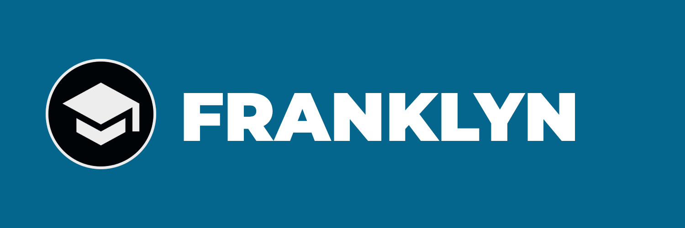

[English](./README.md) | [简体中文](./README.zh-CN.md) | [日本語](./README.ja.md) | Español


[](https://codecov.io/github/2526-4ahitm-itp/2526-4ahitm-franklyn)
[](https://build.opensuse.org/package/show/home:franklyn/franklyn)

---

⚠️ NOTA: Este README puede seguir cambiando durante el desarrollo del proyecto.

## 📘 Descripción del proyecto

Franklyn es un proyecto pensado para ayudar a los docentes transmitiendo la actividad actual de los alumnos a la pantalla del profesor durante pruebas y exámenes. El programa también permite al profesor cambiar entre distintas vistas: puede supervisar a todos los alumnos mediante un pequeño panel que muestra todas las pantallas activas, o ver la pantalla de un solo alumno en el panel detallado.
Franklyn también permitirá al profesor ver las grabaciones de exámenes anteriores. Además, habrá un sistema de inicio de sesión para programar futuros exámenes.

## 🛠️ Instalación

### 📦 Requisitos

- [Gestor de paquetes Nix](https://nixos.org/download/) o [Docker](https://docs.docker.com/engine/install/) / [Podman](https://podman.io/docs/installation)

---

### 🐳 Con Docker

1. Ejecuta `./enter-env.sh`
   - Uso: `./enter-env.sh [podman] [server|hugo|proctor|sentinel]`
   - Se iniciará un contenedor Docker de Nix con volúmenes persistentes y se abrirá
     una shell en la terminal; después continúa en la sección `❄️ Con Nix`.

### ❄️ Con Nix

#### Clona el proyecto y entra en el entorno:

```shell
git clone https://github.com/2526-4ahitm-itp/2526-4ahitm-franklyn
nix develop
```

#### **🔐 Compilar Sentinel**:

```shell
 cd sentinel
 cargo build --release
```

#### **🖥️ Para el Server**:

```shell
 cd server
 mvn clean package -DskipTests=true
```

#### **🌐 Para Proctor**

```shell
cd proctor
bun install
# ejecutar en modo desarrollo
bun run dev
# compilar en dist/
bun run build
```

## 🎓 Cómo usarlo

### 👨‍🎓 Para alumnos

En cuanto el profesor inicie la prueba, aparecerá automáticamente una ventana emergente donde introducirás tu nombre y quedarás conectado a la prueba.

### 👩‍🏫 Para profesores

Inicia sesión en Franklyn Proctor, elige el prefijo de tu cuenta de prueba (p. ej. `testD`) e inicia la prueba.
Después verás la lista de participantes que se han unido a la prueba con sus nombres.

## 👥 Equipo

Supervisores 🧭 - Thomas Stütz [GitHub](https://github.com/htl-leonding), Christian Aberger [GitHub](https://github.com/caberger)

Scrum Master 🌀 - Jakob Huemer-Fistelberger [GitHub](https://github.com/JakobHuemer)

Desarrollador 💻 - Eldin Beganovic [GitHub](https://github.com/EldinBegano)

Desarrollador 💻 - Gregor Geigenberger [GitHub](https://github.com/GregGeig)

Desarrollador 💻 - Clemens Zangenfeind [GitHub](https://github.com/ClemiZ)

## 📄 Licencia

[📝 Licencia MIT](./LICENSE)

## 📘 Documentación adicional

Consulta nuestra documentación [aquí](https://franklyn.htl-leonding.ac.at/en/docs/) (en inglés).
