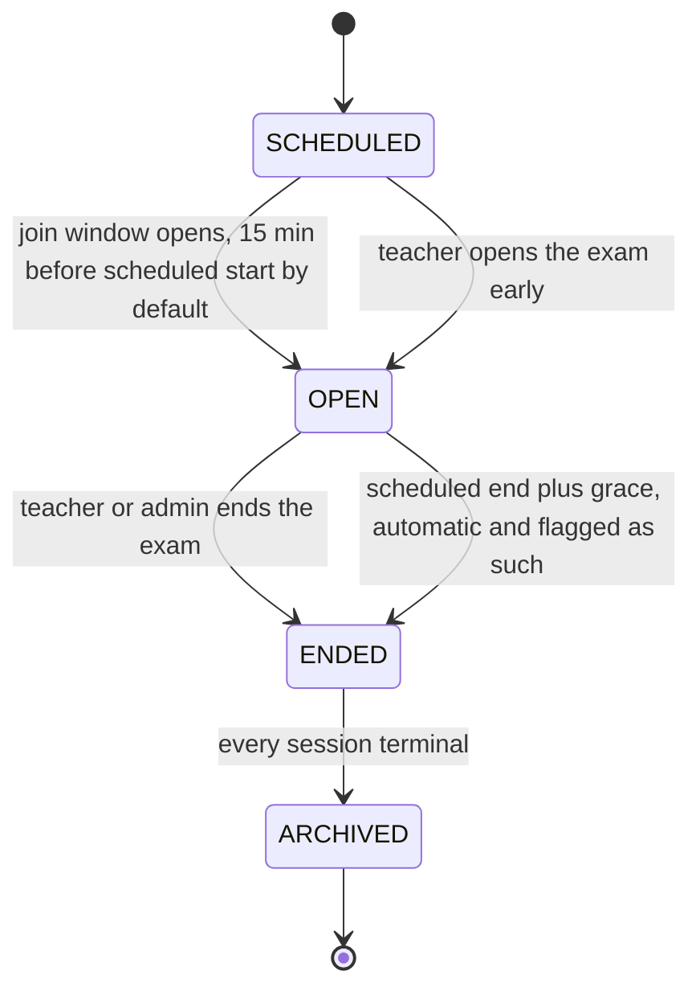
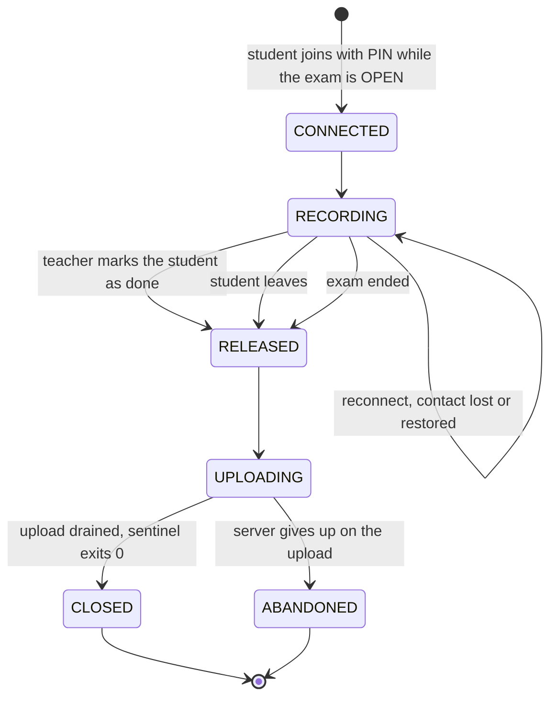



An exam and a student's session are two independent state machines.

## Exam

## Session

One session per student per exam, continuing across reconnects from any machine.

During `UPLOADING` sentinel stays alive and shows progress. The criteria for `ABANDONED` are
decided by the server.

A teacher can release a student while the exam is `OPEN`. A student
who leaves before being marked as released will trigger a signal to the teacher.

Joining after the teacher went live is flagged as a late join.

## Signals

Sentinel reports to proctor over one channel, independent of both state machines:

- results of the preflight checks, which are advisory
- student says they are ready
- student left before being marked
- contact lost and restored

A failed check shows up on the teacher's screen and gets fixed in the room.
