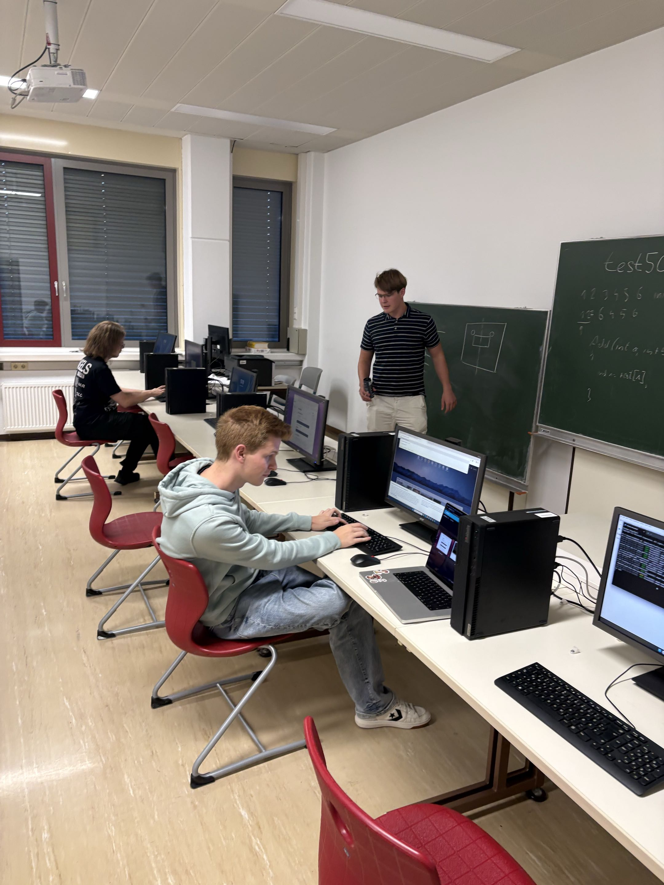
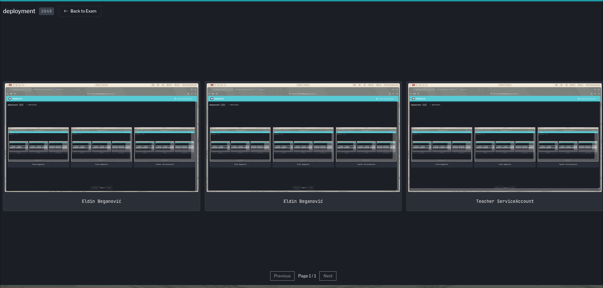
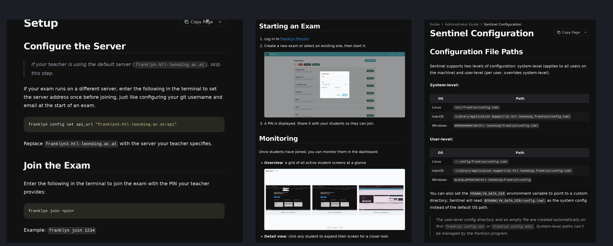
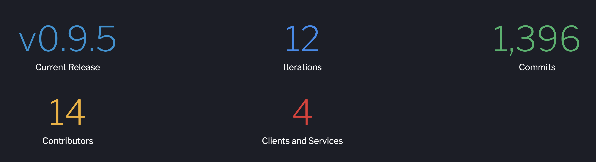

# Franklyn Prinzip und Projektstand

## Ausgangslage

- Schüler schreiben tests am Computer in Schulen
- Lehrer sperren den Internetzugang
- Schüler haben keine Untertützung




## Problemstellung

- Tests ohne Internet sind praxisfern
- Lehrer haben keine Möglichkeit Interneteinsatz zu überprüfen
- Schüler sollen Internet, ohne KI nutzen können

## Team


## Franklyn

- Ermöglicht Lehrer Schüler während dem Test zu beobachten
- Höhere Bildrate als bei den Versionen zuvor
- Speichert das Video eines Schülertests für 30 Tage
- Client schickt bereits ein Video(Server hat keine Arbeit)


## Architektur


## Aktueller Stand
* Unterstützt MacOs
* Unterstützt Windows
* Unterstützt Linux

## Durchlauf

1. Lehrer erstellt den Test
2. Schüler laden sich den Franklyn-Client herunter
3. Schüler connecten sich mit dem Test via PIN
4. Lehrer sehen die Bildschirme der Schüler während des Tests
5. Der Test wird vom Lehrer beendet
6. Der Lehrer kann die fertigen Videos ansehen oder herunterladen

## Sentinel

- Download auf der Webseite

```
franklyn join <pin>
franklyn config set api_url "franklyn3.htl-leonding.ac.at/api"
```

- Rust + GStreamer · X11 und Wayland (XDG desktop portal)
- Layered config: system → user → environment

## Proctor



## Streaming Pipeline

- H.264 encoded auf dem computer des Schülers, kein transcoding am Server
- Verpackt als gesückeltes MP4 — spielt heimisch im browser mittels MSE
- Transportiert über WebSocket mit protobuf Nachrichten
- Anpassbare Bildrate: von 0.2 fps idle bis zu 30 fps mit 1080p

## Meilensteine

| **Bezeichnung** | **Datum** |
|-|-|
|Code Sync Spezifikation mit verifizierten tests, noch nicht im produkt| - |
|Code sync vollständig implementiert im produkt| - |
|Code Delta support für .java implementiert im produkt| - |
| Mac Client full support| 03.11.2027 |

## Dokumentation



- Anleitungen für Schüler, Lehrer, Administratoren und Selbst-Hoster· Diátaxis-Strukturierte Entwickler docs · protocol und media specs

## Statistiken




