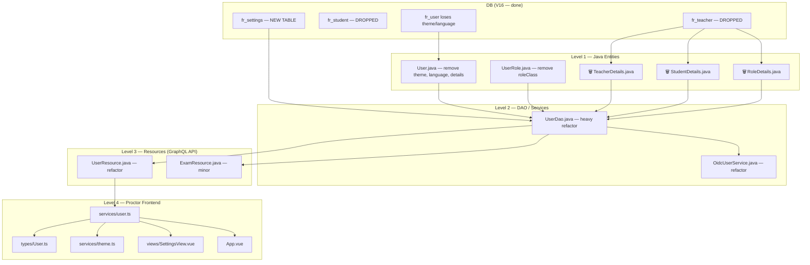

# User Model Refactor — Impact Map

> [!IMPORTANT]
> Migration [V16__user_simplification.sql](file:///home/jakki/projects/franklyn/server/src/main/resources/db/migration/V16__user_simplification.sql) is written.
> Everything below is the code that must change to match.

## Dependency Chain Diagram

---

## 🔴 Level 1 — Java Entities (Direct DB mapping)

### DELETE entirely

| File | Why |
|------|-----|
| [TeacherDetails.java](file:///home/jakki/projects/franklyn/server/src/main/java/at/ac/htlleonding/franklynserver/repository/user/model/TeacherDetails.java) | Maps `fr_teacher` — dropped |
| [StudentDetails.java](file:///home/jakki/projects/franklyn/server/src/main/java/at/ac/htlleonding/franklynserver/repository/user/model/StudentDetails.java) | Maps `fr_student` — dropped |
| [RoleDetails.java](file:///home/jakki/projects/franklyn/server/src/main/java/at/ac/htlleonding/franklynserver/repository/user/model/RoleDetails.java) | Parent interface for above — no purpose |

### REFACTOR

| File | Lines | Change |
|------|-------|--------|
| [User.java](file:///home/jakki/projects/franklyn/server/src/main/java/at/ac/htlleonding/franklynserver/repository/user/model/User.java) | L17-18, L20 | Remove `language`, `theme`, `details` fields |
| [UserRole.java](file:///home/jakki/projects/franklyn/server/src/main/java/at/ac/htlleonding/franklynserver/repository/user/model/UserRole.java) | L6, L8, L10-12 | Remove `roleClass` field + constructor param → plain enum |
| [UserTheme.java](file:///home/jakki/projects/franklyn/server/src/main/java/at/ac/htlleonding/franklynserver/repository/user/model/UserTheme.java) | entire | Stays, but logically belongs to Settings domain now (relocate?) |

### CREATE

| File | Purpose |
|------|---------|
| `Settings.java` (new) | Record: `user_id`, `theme`, `language` — maps `fr_settings` |

---

## 🟠 Level 2 — DAO / Services (Query + Business Logic)

| File | Lines | Change |
|------|-------|--------|
| [UserDao.java](file:///home/jakki/projects/franklyn/server/src/main/java/at/ac/htlleonding/franklynserver/repository/user/UserDao.java) | L17-18 | Remove `TeacherDetails`/`StudentDetails` mapper registrations |
| ↳ | L24, L29, L36 | SQL selects `theme::text, language` from `fr_user` — remove those columns |
| ↳ | L42-53 | `updateUserSettingsInternal` / `updateUserSettings` — must target `fr_settings` |
| ↳ | L55-62 | `findTypedRoleDetails` — queries `fr_teacher`/`fr_student` — **delete** |
| ↳ | L64-85 | `insertDetailedUser` — inserts into `fr_teacher`/`fr_student` — **remove subtype insert logic**, add `fr_settings` insert |
| ↳ | L87-100 | `insertTypedRoleDetails` — **delete** |
| [OidcUserService.java](file:///home/jakki/projects/franklyn/server/src/main/java/at/ac/htlleonding/franklynserver/oidc/OidcUserService.java) | L101-102 | `new User(...)` passes `null, null` for language/theme — remove those args |
| ↳ | L141-147 | Creates `RoleDetails` via switch + passes to `User` constructor — **remove entirely** |
| ↳ | L150 | Calls `insertDetailedUser` — update to new signature |

---

## 🟡 Level 3 — Resources / GraphQL API

| File | Lines | Change |
|------|-------|--------|
| [UserResource.java](file:///home/jakki/projects/franklyn/server/src/main/java/at/ac/htlleonding/franklynserver/resource/user/UserResource.java) | L36 | `.theme(...).language(...)` on User builder → must target Settings |
| ↳ | L38 | `userDao.updateUserSettings(newUser)` → refactor to Settings DAO call |
| ↳ | L47-48 | `roleDetails(@Source User)` resolver → **delete** (no more RoleDetails in schema) |
| ↳ | L51-52 | `exams(@Source TeacherDetails)` → **refactor** to `@Source User` + role check |
| [ExamResource.java](file:///home/jakki/projects/franklyn/server/src/main/java/at/ac/htlleonding/franklynserver/resource/exam/ExamResource.java) | L150 | `findByIdAndType` returns User with old fields — update query |
| [UpdateUserSettings.java](file:///home/jakki/projects/franklyn/server/src/main/java/at/ac/htlleonding/franklynserver/resource/user/model/UpdateUserSettings.java) | L7 | Input model is fine, but calling code must route to Settings DAO |

---

## 🔵 Level 4 — Proctor Frontend

### Type changes

| File | Lines | Change |
|------|-------|--------|
| [User.ts](file:///home/jakki/projects/franklyn/proctor/src/types/User.ts) | L1, L11-12 | Remove `language`, `theme` from `User`; create new `Settings` type |

### GraphQL query changes

| File | Lines | Change |
|------|-------|--------|
| [services/user.ts](file:///home/jakki/projects/franklyn/proctor/src/services/user.ts) | L24-25 | `USER_QUERY` fetches `language`, `theme` on `user { ... }` — must come from Settings |
| ↳ | L31-38 | `UPDATE_SETTINGS_MUTATION` returns `{ id, language, theme }` — adjust return type |
| ↳ | L51-53 | `UpdateSettingsInput` interface — fine, but callers need update |

### Consumers (transitive — depend on User.theme / User.language)

| File | Lines | What reads the old shape |
|------|-------|--------------------------|
| [services/theme.ts](file:///home/jakki/projects/franklyn/proctor/src/services/theme.ts) | L48-49 | `user.value?.theme` → read from Settings |
| [SettingsView.vue](file:///home/jakki/projects/franklyn/proctor/src/views/SettingsView.vue) | L22, L33, L51-52, L64-65 | Watches + writes `user.theme` / `user.language` → Settings |
| [App.vue](file:///home/jakki/projects/franklyn/proctor/src/App.vue) | L72 | `next.language` from user watcher → Settings |

---

## ⚠️ Docs / Specs / HTTP (non-code)

| File | Lines | Issue |
|------|-------|-------|
| [schema.puml](file:///home/jakki/projects/franklyn/hugo/content/en/docs/explanation/server-logistics/schema.puml) | L12-15, L27-30, L39-41 | 🔴 Shows `fr_teacher`/`fr_student` entities + relationships — **stale** |
| [auth-identity/spec.md](file:///home/jakki/projects/franklyn/openspec/specs/auth-identity/spec.md) | L81, L87 | ⚠️ "create a Teacher or Student DB record" — outdated |
| `server/http/get users.yml` | L14-15 | ⚠️ Queries `language`/`theme` on `userInfo` — **protected file**, verify only |
| `server/http/get sentinel sessions.yml` | L12-13 | ⚠️ Uses `allStudents` query name — **protected file**, verify only |
| `ios/graphql/schema.graphqls` | L23 | ℹ️ `teacherId` on `Test` — likely legacy/unused |

---

## 🧪 Tests

| File | Lines | Change |
|------|-------|--------|
| [UserDaoTest.java](file:///home/jakki/projects/franklyn/server/src/test/java/at/ac/htlleonding/franklynserver/repository/user/UserDaoTest.java) | L9-10, L35-36, L49-51, L61-63, L69-71, L92-112, L114-125 | Heavy refactor: remove `fr_teacher`/`fr_student` cleanup, remove `TeacherDetails`/`StudentDetails` usage, remove `theme`/`language` on User |
| [VideoRetentionServiceTest.java](file:///home/jakki/projects/franklyn/server/src/test/java/at/ac/htlleonding/franklynserver/service/VideoRetentionServiceTest.java) | L24-25, L28, L69-72, L82-83 | Remove `TeacherDetails`/`StudentDetails` usage, remove `fr_teacher`/`fr_student` cleanup |

---

## ℹ️ No Action Needed

- **Flyway V1–V15** — historical, immutable
- **Sentinel** — clean, no references
- **Hugo guides/slides** — "Student"/"Teacher" as user-facing labels, not entity names
- **`.idea/dataSources/`** — auto-refreshes on DB introspect
- **Proctor `services/exams.ts`** — `teacherId` field name stays (column not renamed)
- **Proctor `services/sessions.ts`** — `studentId` field name stays (column not renamed)
- **Proctor role checks** (`useRoles()`, router guards) — use Keycloak token, not entity types
